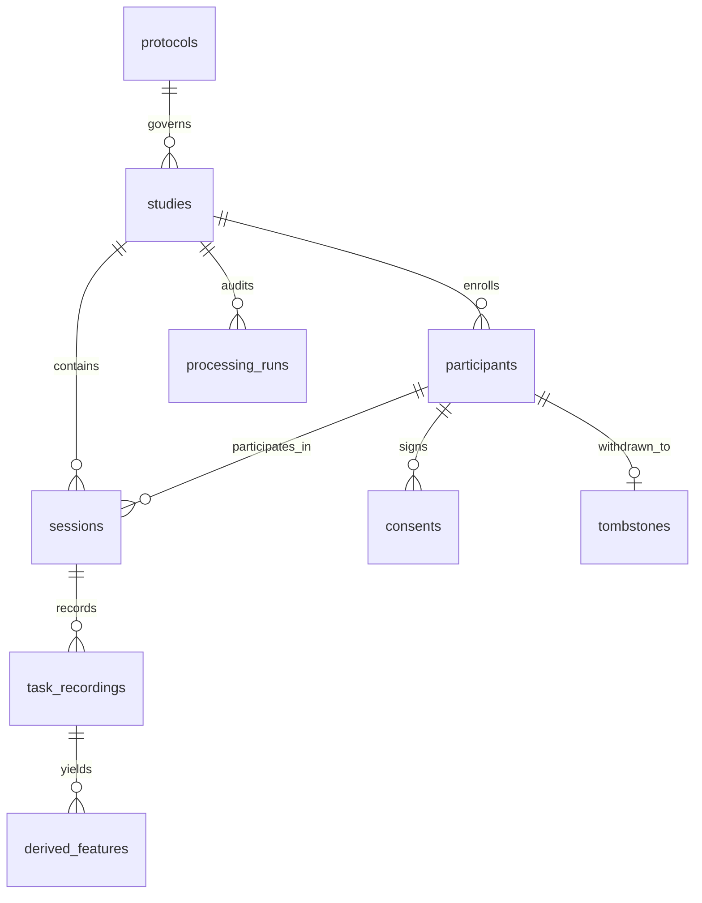

# Milestone 5 Database Schema Specification

**System:** VoxNeuro Research Study Operations Layer  
**Engine:** SQLite 3 (version 3.40+)  
**Configuration:** `PRAGMA foreign_keys = ON;`, `row_factory = sqlite3.Row`  
**Migration Path:** `src/voxneuro/study/migrations/` (`001_initial_study_schema.sql`, `002_participant_study_constraints.sql`, `003_composite_foreign_keys_and_retention_defaults.sql`)  
**Execution Strategy:** Transactional atomic runner (`BEGIN IMMEDIATE ... COMMIT/ROLLBACK`)  

---

## 1. Overview and Relational Architecture

The Milestone 5 database provides an immutable, privacy-preserving operational backing store for speech biomarker research studies, longitudinal cohort management, Data Use Agreements (DUA), informed consent state tracking, and cryptographic auditability.

---

## 2. Table Specifications

### 2.1 `schema_migrations`
Tracks sequentially applied versioned database migrations.
- `version` (INTEGER PRIMARY KEY): Monotonically increasing migration sequence number.
- `name` (TEXT NOT NULL): Descriptive migration filename (e.g. `001_initial_study_schema.sql`).
- `applied_at` (TEXT NOT NULL): ISO 8601 UTC timestamp of execution.

### 2.2 `protocols`
Defines an immutable scientific protocol specification.
- `protocol_id` (TEXT NOT NULL): Unique protocol family identifier.
- `protocol_version` (TEXT NOT NULL): Semantic version of the protocol specification.
- `tasks_json` (TEXT NOT NULL): JSON array of permitted speech task types (`sustained_vowel`, `ddk`, `connected_speech`, `vowel_space`).
- `visits_expected` (INTEGER NOT NULL DEFAULT 1): Planned number of longitudinal visits.
- `minimum_interval_days` (INTEGER NOT NULL DEFAULT 0): Enforced minimum spacing between visits.
- `instructions` (TEXT NOT NULL DEFAULT ''): Researcher operational instructions.
- `created_at` (TEXT NOT NULL): ISO 8601 UTC timestamp.
- **Primary Key:** `(protocol_id, protocol_version)`

### 2.3 `studies`
Research study entity linking participant cohorts, protocols, and data policies.
- `study_id` (TEXT PRIMARY KEY): Unique study identifier (e.g. `STUDY-PARK-01`).
- `study_name` (TEXT NOT NULL): Full human-readable study title.
- `study_description` (TEXT NOT NULL): Objective and summary of research scope.
- `protocol_id` (TEXT NOT NULL): Foreign key to `protocols(protocol_id)`.
- `protocol_version` (TEXT NOT NULL): Foreign key to `protocols(protocol_version)`.
- `study_status` (TEXT NOT NULL DEFAULT 'draft'): State machine (`draft`, `active`, `paused`, `completed`, `archived`).
- `research_site_id` (TEXT NOT NULL DEFAULT 'primary_site'): Primary participating research facility.
- `dataset_id` (TEXT NOT NULL): Foreign key referencing `dataset_access(dataset_id)`.
- `dataset_version` (TEXT NOT NULL DEFAULT 'v1'): Registered dataset version.
- `created_at` (TEXT NOT NULL): ISO 8601 UTC timestamp.
- `updated_at` (TEXT NOT NULL): ISO 8601 UTC timestamp.
- `study_owner_role` (TEXT NOT NULL DEFAULT 'Principal Investigator'): Responsible investigator role.
- `consent_requirements_json` (TEXT NOT NULL DEFAULT '[]'): Required consent components.
- `data_retention_policy_id` (TEXT NOT NULL): Retention policy identifier.
- `analysis_configuration_id` (TEXT NOT NULL): Standard analysis pipeline config reference.

### 2.4 `participants`
Pseudonymous cohort management with zero direct personal identifiers.
- `participant_id` (TEXT PRIMARY KEY): Random pseudonymous token (`PT-XXXXXXXXXXXX`). Direct PII strictly prohibited.
- `study_id` (TEXT NOT NULL): Foreign key to `studies(study_id)`.
- `enrollment_status` (TEXT NOT NULL): Status (`enrolled`, `active`, `completed`, `withdrawn`, `screen_failed`).
- `consent_status` (TEXT NOT NULL): Current consent state (`consented`, `pending`, `withdrawn`, `expired`, `reconsent_required`). Defaults to `pending`.
- `consent_version` (TEXT NOT NULL): Most recently executed consent document version. Defaults to `none`.
- `enrollment_timestamp` (TEXT NOT NULL): ISO 8601 UTC timestamp of enrollment.
- `withdrawal_timestamp` (TEXT): ISO 8601 UTC timestamp of consent revocation.
- `site_id` (TEXT NOT NULL DEFAULT 'primary_site'): Collection site identifier.
- `allowed_research_scopes_json` (TEXT NOT NULL DEFAULT '[]'): Permitted research uses.
- `participant_metadata_status` (TEXT NOT NULL DEFAULT 'VERIFIED_DEIDENTIFIED'): Verification state.
- **Composite Unique Constraint:** `UNIQUE (participant_id, study_id)`

### 2.5 `consents`
Individual informed consent records and task-specific authorizations.
- `consent_record_id` (TEXT PRIMARY KEY): Unique consent submission identifier.
- `participant_id` (TEXT NOT NULL): Participant identifier.
- `study_id` (TEXT NOT NULL): Study identifier.
- `consent_form_version` (TEXT NOT NULL): Form version agreed to.
- `consent_date` (TEXT NOT NULL): ISO 8601 timestamp.
- `scope_of_permission_json` (TEXT NOT NULL): JSON array of permitted scopes.
- `permitted_recording_tasks_json` (TEXT NOT NULL): Permitted tasks (`sustained_vowel`, `ddk`, `connected_speech`, `vowel_space`).
- `permitted_research_uses_json` (TEXT NOT NULL): Authorized secondary research purposes.
- `permission_to_retain_derived_features` (INTEGER NOT NULL DEFAULT 0): Retention authorization for tabular numbers (defaults to 0 / False; feature retention requires explicit affirmative consent).
- `permission_to_retain_audio` (INTEGER NOT NULL DEFAULT 0): Audio persistence flag (always 0 in current prototype).
- `withdrawal_status` (INTEGER NOT NULL DEFAULT 0): Active (0) or revoked (1).
- `revocation_date` (TEXT): Date of revocation if withdrawn.
- `source_document_reference` (TEXT NOT NULL): Tracking code of signed physical/electronic document.
- **Composite Foreign Key:** `FOREIGN KEY (participant_id, study_id) REFERENCES participants(participant_id, study_id)`
- **Composite Unique Constraint:** `UNIQUE (consent_record_id, participant_id, study_id)`

### 2.6 `dataset_access`
Data Use Agreements (DUA) and dataset governance.
- `dataset_id` (TEXT PRIMARY KEY): Unique dataset identifier (e.g. `uams_telephone_v1`).
- `dataset_version` (TEXT NOT NULL): Version string.
- `dataset_owner` (TEXT NOT NULL): Data controlling institution.
- `license_type` (TEXT NOT NULL): Research or commercial license type.
- `access_approval_state` (TEXT NOT NULL): Approval state (`APPROVED`, `PENDING`, `REJECTED`, `EXPIRED`, `SUSPENDED`).
- `dua_state` (TEXT NOT NULL): DUA execution state (`ACTIVE`, `PENDING`, `EXPIRED`, `NOT_REQUIRED`, `TERMINATED`).
- `permitted_tasks_json` (TEXT NOT NULL): Permitted speech tasks.
- `permitted_data_processing_operations_json` (TEXT NOT NULL): Permitted analytical pipelines.
- `storage_restrictions` (TEXT NOT NULL): Data handling rules.
- `publication_restrictions` (TEXT NOT NULL): Rules for aggregate results dissemination.
- `expiration_date` (TEXT): Expiration date if term-limited.
- `source_documentation` (TEXT NOT NULL): DUA agreement tracking identifier.

### 2.7 `sessions`
Longitudinal research recording visits.
- `session_id` (TEXT PRIMARY KEY): Unique session identifier.
- `study_id` (TEXT NOT NULL): Study identifier.
- `protocol_version` (TEXT NOT NULL): Protocol version enforced during recording.
- `participant_id` (TEXT NOT NULL): Participant identifier.
- `visit_index` (INTEGER NOT NULL DEFAULT 1): Sequential visit count (1 = Baseline, 2 = Follow-up 1, etc.).
- `visit_label` (TEXT NOT NULL DEFAULT 'Baseline'): Human-readable visit name.
- `acquisition_domain_id` (TEXT NOT NULL): Target recording domain.
- `capture_origin` (TEXT NOT NULL): Provenance origin.
- `recording_timestamp` (TEXT NOT NULL): ISO 8601 recording time.
- `consent_reference` (TEXT NOT NULL): Exact pinned consent record ID (`consent_record_id`).
- `device_metadata_json` (TEXT NOT NULL DEFAULT '{}'): Recording transducer metadata.
- `task_completion_states_json` (TEXT NOT NULL DEFAULT '{}'): Completion status per task.
- `qc_results_json` (TEXT NOT NULL DEFAULT '{}'): Operational quality metrics.
- `processing_receipt_sha256` (TEXT): Cryptographic hash of batch processing run.
- `missing_task_reasons_json` (TEXT NOT NULL DEFAULT '{}'): Structured failure or omission reasons.
- `overall_session_status` (TEXT NOT NULL DEFAULT 'SCHEDULED'): State (`SCHEDULED`, `IN_PROGRESS`, `COMPLETED`, `QUALITY_FAILED`, `RESTRICTED_WITHDRAWN`).
- **Composite Foreign Keys:**
  - `FOREIGN KEY (participant_id, study_id) REFERENCES participants(participant_id, study_id)`
  - `FOREIGN KEY (consent_reference, participant_id, study_id) REFERENCES consents(consent_record_id, participant_id, study_id)`

### 2.8 `task_recordings`
Speech task executions within a session.
- `task_id` (TEXT PRIMARY KEY): Unique recording record identifier.
- `session_id` (TEXT NOT NULL): Foreign key to `sessions(session_id)`.
- `task_type` (TEXT NOT NULL): Task identifier (`sustained_vowel`, `ddk`, `connected_speech`, `vowel_space`).
- `task_status` (TEXT NOT NULL DEFAULT 'NOT_STARTED'): Execution status (`NOT_STARTED`, `RECORDED`, `FEATURES_EXTRACTED`, `QUALITY_FAILED`, `PROCESSING_FAILED`, `SKIPPED`).
- `audio_duration_seconds` (REAL NOT NULL DEFAULT 0.0): Phonation duration.
- `quality_passed` (INTEGER NOT NULL DEFAULT 0): Operational screening flag.
- `rejection_reason` (TEXT): Failure description if quality rejected.
- `feature_schema_version` (TEXT): Acoustic schema version (e.g. `voxneuro.voice.v3`).
- `feature_schema_fingerprint` (TEXT): Deterministic 64-character hex schema fingerprint.
- `derived_feature_count` (INTEGER NOT NULL DEFAULT 0): Number of extracted acoustic measures.
- `qc_metrics_json` (TEXT NOT NULL DEFAULT '{}'): Task acoustic screening measurements.
- `created_at` (TEXT NOT NULL): ISO 8601 UTC timestamp.
- **Unique Constraint:** `(session_id, task_type)`

### 2.9 `derived_features`
Acoustic feature representations extracted from audio without storing raw audio bytes.
- `feature_record_id` (TEXT PRIMARY KEY): Unique feature extraction row ID.
- `task_id` (TEXT NOT NULL): Foreign key to `task_recordings(task_id)`.
- `session_id` (TEXT NOT NULL): Foreign key to `sessions(session_id)`.
- `participant_id` (TEXT NOT NULL): Foreign key to `participants(participant_id)`.
- `task_type` (TEXT NOT NULL): Task name.
- `schema_version` (TEXT NOT NULL): Schema version.
- `features_json` (TEXT NOT NULL): JSON object mapping feature names to numerical measurements.
- `created_at` (TEXT NOT NULL): ISO 8601 UTC timestamp.

### 2.10 `processing_runs`
Immutable cryptographic receipts of batch analytical processing runs.
- `run_id` (TEXT PRIMARY KEY): Unique processing run identifier.
- `study_id` (TEXT NOT NULL): Foreign key to `studies(study_id)`.
- `session_ids_json` (TEXT NOT NULL): JSON array of included session IDs.
- `processing_timestamp` (TEXT NOT NULL): ISO 8601 UTC execution timestamp.
- `application_version` (TEXT NOT NULL): VoxNeuro application release version.
- `project_code_fingerprint` (TEXT NOT NULL): Cryptographic hash of codebase.
- `python_version` (TEXT NOT NULL): Host Python runtime version.
- `dependency_lockfile_fingerprint` (TEXT NOT NULL): Dependency verification token.
- `task_schema_fingerprints_json` (TEXT NOT NULL): Cryptographic fingerprints of all task schemas.
- `audio_config_fingerprint` (TEXT NOT NULL): Hash of `audio_config.yaml`.
- `feature_config_fingerprint` (TEXT NOT NULL): Hash of `feature_config.yaml`.
- `domain_metadata_fingerprint` (TEXT NOT NULL): Hash of domain registry.
- `input_file_checksum` (TEXT): Digest of input data if batch processed.
- `feature_table_checksum` (TEXT NOT NULL): SHA-256 checksum of generated feature table.
- `processing_status` (TEXT NOT NULL): Execution status.
- `exclusion_summary_json` (TEXT NOT NULL DEFAULT '{}'): Breakdown of excluded items.
- `error_summary_json` (TEXT NOT NULL DEFAULT '{}'): Breakdown of operational errors.
- `output_artifact_checksums_json` (TEXT NOT NULL DEFAULT '{}'): Hashes of generated artifacts.
- `receipt_sha256` (TEXT NOT NULL): Cryptographic digest over the entire receipt payload.

### 2.11 `audit_log`
Privacy-sanitized operational audit trail.
- `log_id` (INTEGER PRIMARY KEY AUTOINCREMENT): Sequence order.
- `timestamp_utc` (TEXT NOT NULL): ISO 8601 UTC event timestamp.
- `operation_type` (TEXT NOT NULL): Operation name (e.g. `PARTICIPANT_REGISTERED`, `WITHDRAWAL_COMPLETED`).
- `entity_type` (TEXT NOT NULL): Target entity (`participant`, `session`, `study`, `processing_run`).
- `entity_id` (TEXT NOT NULL): Entity identifier.
- `actor_role` (TEXT NOT NULL DEFAULT 'researcher'): Role executing the operation.
- `details_json` (TEXT NOT NULL DEFAULT '{}'): Sanitized metadata with PII keys permanently redacted.

### 2.12 `tombstones`
Irreversible cryptographic record of consent revocation and data deletion.
- `tombstone_id` (TEXT PRIMARY KEY): Unique tombstone record ID (`tomb-XXXXXXXXXXXX`).
- `timestamp_utc` (TEXT NOT NULL): Revocation timestamp.
- `participant_pseudonym_hash` (TEXT NOT NULL): Salted SHA-256 digest of participant pseudonym.
- `study_id` (TEXT NOT NULL): Study from which data was deleted.
- `deletion_reason` (TEXT NOT NULL): Stated justification (e.g. consent withdrawal).
- `records_deleted_count` (INTEGER NOT NULL): Count of derived feature rows deleted.
- `policy_reference` (TEXT NOT NULL): Governing IRB / DUA policy reference.
