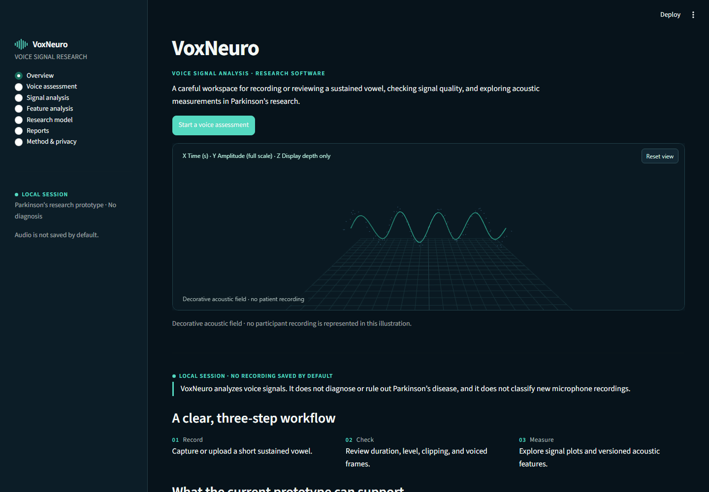
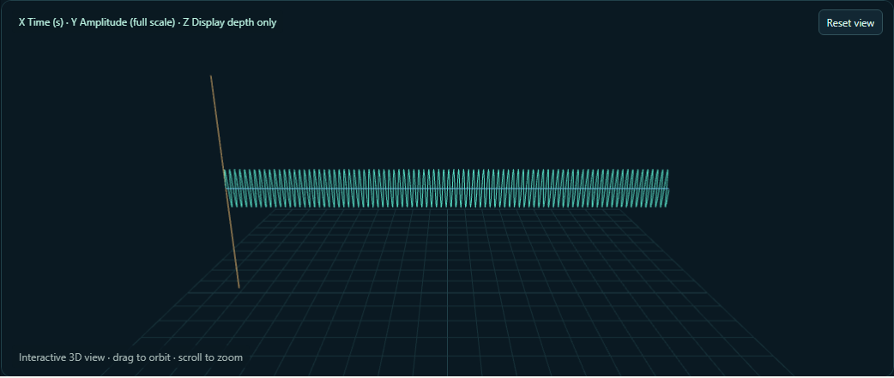
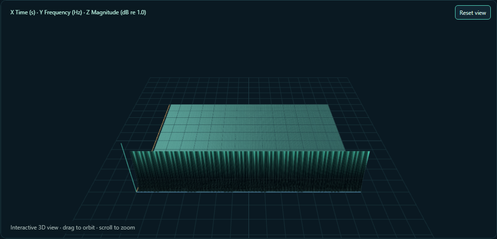

# Browser smoke screenshots

These screenshots were generated by `frontend/acoustic-visualizer/smoke-test.mjs` using a synthetic 3.4-second, 180 Hz PCM WAV in local headless Chrome 156. They contain no participant recording or personal data. The Overview ribbon is explicitly decorative; the other two images visualize the generated synthetic signal and its computed STFT.

